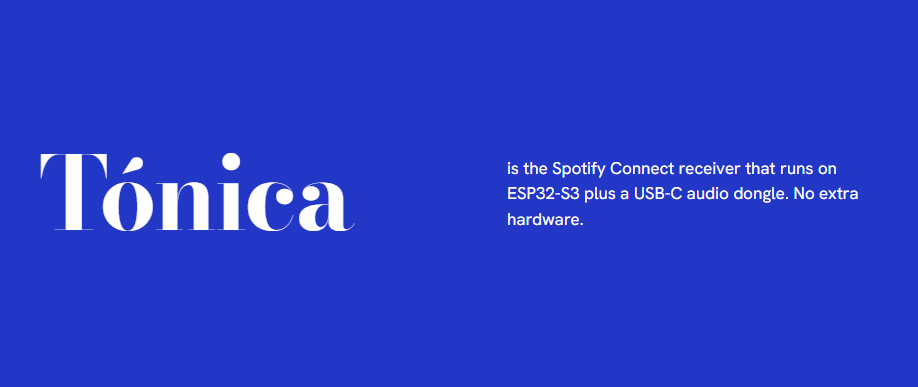

<h1></h1>

<p align="center">
<a href="https://tonica.m44.cl"><strong>Install</strong> (latest)</a> •
<a href="https://github.com/MMMXXXZZZ/tonica-esp32/issues"><strong>Report a bug</strong></a> •
<a href="https://tonica.m44.cl/licenses.txt"><strong>Licenses</strong></a>
</p>

<p align="center">
A Spotify Connect solution for the ESP32-S3, member of the **Listenica** family.
</p>

<p align="center">
<a href="https://github.com/MMMXXXZZZ/tonica-esp32/actions/workflows/tonica-esp32.yml"></a>
<a href="https://github.com/MMMXXXZZZ/tonica-esp32/actions/workflows/listenica-windows.yml"></a>
<a href="https://github.com/MMMXXXZZZ/tonica-esp32/actions/workflows/listenica-macos.yml"></a>
</p>

## About

Tónica is a clean-room Spotify Connect receiver modelled on [librespot](https://github.com/librespot-org/librespot).
It runs entirely on the board (no Pi or PC in the audio path), shows up in the Spotify app like any Connect
speaker, logs in with your own Premium account and plays through a USB-C audio adapter (or an I2S DAC).

Spotify's [Soloist](https://github.com/spotify/soloist) is closed-source and only ships binaries for desktop
operating systems, so it can't be ported; this project reimplements the same role (`docs/soloist-study.md`).

| Name | Role | Status |
| --- | --- | --- |
| **Listenica** | Shared core (`core/`, namespace `listenica::`): Spotify protocol and player. Later also a home server (library, presets, multi-room clock, other services such as Tidal, see `docs/tidal-study.md`) | core: in use |
| **Tónica** | This firmware (`tonica/`): one ESP32-S3 speaker, self-sufficient | working |
| **Sinfónica** | Multi-speaker Tónica on stronger hardware, sample-synced groups | idea |

## Features

- **Playback:** Ogg Vorbis up to 320 kbps (default), gapless, instant starts from Spotify's head files, the next 3
  tracks preloaded (~0.1 s skips), seek, shuffle/repeat, queue, autoplay (gapless into it, follows the account's
  Autoplay switch live), Like (adds to Liked Songs), short fades on pause and play. Decoding runs at ~6.3x realtime.
- **Audible notifications (optional, Gemini TTS with your API key):** spoken over the music (ducked) or alone. "Now
  playing" with every artist when the button starts music or on 4 presses; who took over as a guest; Like, pair
  mode, Wi-Fi setup, autoplay, Wi-Fi lost / back online, login expired. Fixed phrases are stored on the board
  (they work offline); names are rendered live.
- **Sharing:** the owner (saved account) always wins; anyone can take over as a temporary guest (never saved), or
  only while the owner isn't using it, or not at all. A pairing window after boot lets someone claim the speaker as
  a temporary owner. Guests return to the owner after inactivity.
* **Button (BOOT):** 1 / 2 / 3 / 4 presses = play-pause / next / previous / what's playing; press + hold = volume down,
  double-press + hold = volume up; hold 1 s Like, 4 s pair mode, 7 s back to the owner, 10 s Wi-Fi setup,
  13 s cancel. The RGB LED previews each hold. With nothing playing, one press resumes a recent session or plays
  your preset (Liked Songs or a playlist; default, shuffle, newest first, playlist radio or resume).
* **Setup page:** hold the button 10 s (or boot without Wi-Fi) for the `Tónica-Setup-xxxx` hotspot. Its page sets
  Wi-Fi, name, quality, sharing (and shows the owner), timeouts, the button preset (with your playlists) and audible
  notifications (API key, voice from Google's live list, style, preview on the speaker), and shows a button guide.
* **Upkeep:** OTA updates over Wi-Fi in ~8 s (playback fades out and resumes after), automatic rollback, recovery
  watchdog, a persistent event log, LED status codes (E4: playback stopped because Spotify refuses this account's
  tracks). Power-on to ready in ~7.5 s (cached endpoints, no clock wait on warm boots).

## Hardware

- YD-ESP32-S3 N16R8 (16 MB flash, 8 MB octal PSRAM). Flash through the **COM** (CH343) USB-C port; power it from a
  5 V / 1 A wall adapter for listening (PC USB power crackles).
- Audio: a USB-C audio adapter on the native **USB** port (bridge the board's **USB-OTG** pads), or an I2S DAC
  (PCM5102A / MAX98357A: BCK=GPIO5, WS=GPIO6, DIN=GPIO7; pins in `settings.conf`).
- The RGB LED needs the board's **RGB** solder jumper bridged.

## Building

```powershell
tonica\build.ps1                              # build (applies tonica\settings.conf first)
tonica\build.ps1 flash COM5                   # first flash over USB
# no Wi-Fi saved: join the "Tónica-Setup-xxxx" hotspot and pick your network, then sign in to
# Spotify with the code the setup page shows (the first account becomes the owner)
```

On the LAN the board serves `/status`, `/log` and `/events` (event history), plus `/ota` (token-protected).
`secrets/` holds OAuth tokens, reusable credentials, the device id and the OTA token.

## Licences

Tónica and Listenica are MIT-licensed ([`LICENSE`](LICENSE)). Third-party software in the firmware and the host, with its licences: [`THIRD_PARTY_NOTICES.md`](THIRD_PARTY_NOTICES.md) (full texts in [`licenses/`](licenses/)).