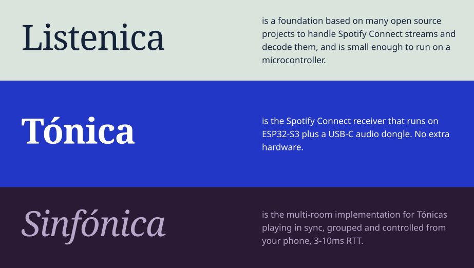

<h1 align="center"></h1>

<p align="center">
<a href="https://tonica.m44.cl"><strong>Install</strong> (latest)</a> •
<a href="https://github.com/MMMXXXZZZ/tonica-esp32/issues"><strong>Report a bug</strong></a> •
<a href="https://tonica.m44.cl/licenses.txt"><strong>Licenses</strong></a>
</p>

<p align="center">
A Spotify Connect solution for the ESP32-S3, member of the <strong>Listenica</strong> family.
</p>

<p align="center">
<a href="https://github.com/MMMXXXZZZ/tonica-esp32/actions/workflows/tonica-esp32.yml"></a>
<a href="https://github.com/MMMXXXZZZ/tonica-esp32/actions/workflows/listenica-windows.yml"></a>
<a href="https://github.com/MMMXXXZZZ/tonica-esp32/actions/workflows/listenica-macos.yml"></a>
</p>

## About

Tónica is a clean-room Spotify Connect receiver modelled on [librespot](https://github.com/librespot-org/librespot).
It runs entirely on the board (no Pi or PC in the audio path), shows up in the Spotify app like any Connect
speaker, logs in with your own Premium account and plays through a USB-C audio adapter (or an I2S DAC).

- **Listenica**: Shared protocol and player core. Also an executable to test network's multi-room capabilities
- **Tónica**: ESP32-S3 speaker, self-sufficient
- **Sinfónica**: Multi-speaker Tónica mode, automatic discovery and sync

## Features

- Gapless, queues, autoplay, Jams, "Like" song.
- Decoding 'Very High' 320 kbps on ESP32-S3 at ~6.3x.
- Web install, Wi-Fi and settings setup at [tonica.m44.cl](https://tonica.m44.cl) via USB.
- Attached to your Spotify Premium account. Share the speaker or restrict it to deny guests.
- BOOT button on the ESP-32 board acts as main control (playback, "what's playing", volume, hotspot setup, Sinfónica multiroom).
- Add optional Gemini TTS API key for audible notitications ("What's Playing?")
- Auto-updates, LED status codes, fast-boot, automatic recovery and update rollback on failure.

## Hardware

- YD-ESP32-S3 N16R8 (16 MB flash, 8 MB octal PSRAM). Flash through the **COM** (CH343) USB-C port; power it from a
  5 V / 1 A wall adapter for listening (PC USB power crackles).
- Audio: a USB-C audio adapter on the native **USB** port (bridge the board's **USB-OTG** pads), or an I2S DAC
  (PCM5102A / MAX98357A: BCK=GPIO5, WS=GPIO6, DIN=GPIO7; pins in `settings.conf`).
- The RGB LED needs the board's **RGB** solder jumper bridged.

## Building

```powershell
tonica\build.ps1                              # build (applies tonica\settings.conf first)
tonica\build.ps1 flash COM5                   # first flash over USB
# if you didn't add Wi-Fi creds, join "Tónica-Setup-xxxx" hotspot to set up, then sign in to
# Spotify with the code shown
```

On LAN the board serves `/status`, `/log` and `/events` (event history), plus `/ota` (token-protected).
`secrets/` holds OAuth tokens, reusable credentials, the device id and the OTA token.

## Licences

Tónica and Listenica are MIT-licensed ([`LICENSE`](LICENSE)). Third-party software in the firmware and the host, with its licences: [`THIRD_PARTY_NOTICES.md`](THIRD_PARTY_NOTICES.md) (full texts in [`licenses/`](licenses/)).